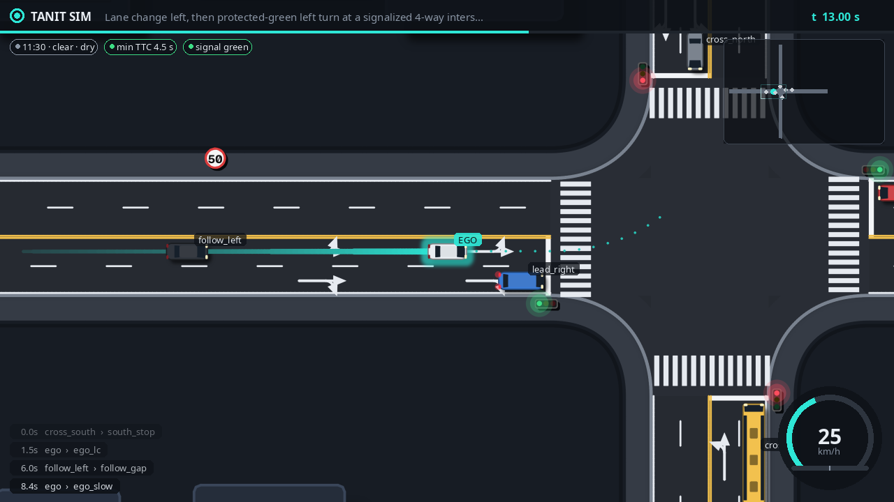
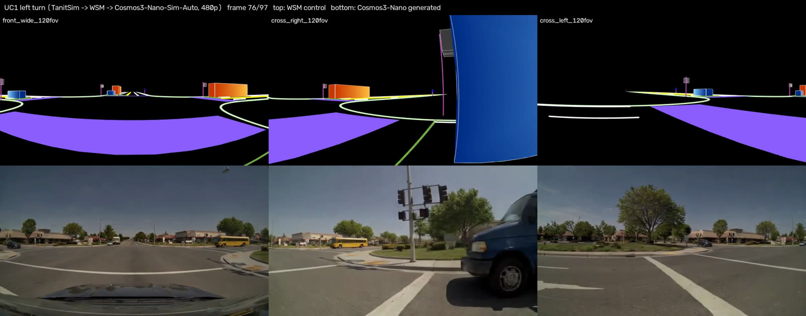

# Tanit Scenario Flywheel

**Text, dash-cam video, incidents and sensor logs in; verified OpenDRIVE + OpenSCENARIO, Cosmos-rendered
multi-camera data and closed-loop KPIs out. Everything runs on one Jetson AGX Thor.**

A sub-programme of TanitAD. Every source is *lifted* into one typed scenario IR (TSIR). TSIR is *compiled*
deterministically to OpenDRIVE 1.8, OpenSCENARIO 1.3 XML, OpenSCENARIO DSL 2 and the IMDAD
`Scenario_Structure` package. A verifier ladder then proves each scenario before anything expensive runs.
The LLM never writes XML.

| | |
|---|---|
|  |  |
| TanitSim 2D: the spec's UC1 query (lane change left, then a protected left turn at a signalised junction) | The same scenario: WSM controls (top) and Cosmos3-Nano-Sim-Auto (bottom), 3 of 7 cameras, on the Thor |

Evidence videos (synthetic scenarios): [UC1 BEV](docs/media/uc1_left_turn_bev.mp4) ·
[UC1 WSM 7-camera controls](docs/media/uc1_left_turn_intersection_wsm_mosaic.mp4) ·
[Cosmos Sim-Auto, 3 cameras](docs/media/uc1_cosmos_sim_auto_3cam.mp4) ·
[Cosmos Sim-Auto, 10 s](docs/media/uc1_cosmos_sim_auto_10s.mp4) ·
[double cut-in BEV](docs/media/double_cut_in_bev.mp4) ·
[double cut-in, Cosmos Transfer-Auto](docs/media/double_cut_in_cosmos_transfer_auto.mp4)

## Use cases
| UC | Input | Flywheel |
|---|---|---|
| 1 | Text request | Qwen3.8-27B (NVFP4, vLLM, grammar-constrained) analyst, then proposer, then the verifier ladder, then minimal-edit repair; then TanitSim, augmentation, WSM/Cosmos and closed loop |
| 2 | Dash-cam video, no ego data | NVIDIA ViPE metric ego motion plus a VLM keyframe scene description, then UC1 lifting; the ego speed profile is a checked constraint |
| 3 | IMDAD NEGATIVE incident | Incident brief, then a verified COUNTERFACTUAL_POSITIVE twin, validated against `incident_schema_v2` |
| 4 | Sensor snippet with GT ego (PhysicalAI-AV) | Deterministic log lifting (Frenet reference, lane topology, track stitching), re-simulation fidelity, analysis |
| 5 | Negative snippet | The lifted log is the NEGATIVE; the LLM writes only an ego plan spliced into a copy, so every other road user keeps its logged behaviour; relative positive criteria |

## What makes it work
- **Verifier ladder as the reward.**
  - L0: TSIR schema.
  - L1: compile, plus XSD validation (OpenDRIVE via XSD 1.1, OpenSCENARIO 1.3) and ASAM Quality Checker.
  - L2: lane-graph continuity and junction topology.
  - L3: simulation assertions with *quantitative* repair hints (e.g. "start the ego ≤ 35 m before the junction").
- **Harness² with hard verifiers.** Frozen weights; prompt, guardrails, skills and lessons evolve through Propose–Probe–Compose and are adopted only on a ladder-score gain without regressions.
- **TanitSim.** Own OpenDRIVE engine, ACC (IDM + CAH) drivers with lifted headways, signals, yielding, OBB collisions, TTC, and MOBIL-safe replayed lane changes. Simulation runs at ~100–900× real time.
- **Ablation against one-shot prompting.** Each condition is scored for validity and for request intent (manoeuvres actually executed in simulation), on probe and held-out queries: see the report.
- **Cosmos 3 on a shared Thor.**
  - A patch sizes Sim-Auto's KV ring to the requested views, so it runs next to the resident LLM inside 122 GB of unified memory.
  - Captions are written from the TSIR, never from templates; template captions invent actors.

## Repository
```
src/tsf/ir          TSIR (pydantic) + JSON schema for constrained decoding
src/tsf/compile     OpenDRIVE / OSC 1.3 / OSC DSL 2 compilers
src/tsf/verify      verifier ladder (L0-L3, XSD, ASAM QC)
src/tsf/sim         TanitSim engine, OpenDRIVE reader, BEV renderer
src/tsf/agents      LLM client, Lifter, Harness² evolver, ablation, UC2 video, UC3 incidents, UC4/5 snippets
src/tsf/ingest      PhysicalAI-AV log lifting, ViPE ego tracks
src/tsf/cosmos      RDS-HQ export, WSM controls, Cosmos3-Nano Sim/Transfer-Auto, captions
src/tsf/closedloop  closed-loop runner, test policies, REFe SFT-4 adapter (f-theta -> NAVSIM pinhole)
src/tsf/server      FastAPI (runs, artifacts, live events, harness, KPIs, evidence)
ui/                 operator console (React/Vite): Studio, Runs, scene viewer, Harness, Evidence, KPIs
report/             LaTeX technical report + KPI aggregation (make_results.py)
spec/imdad          IMDAD scenario / incident schemas (output contract)
```

## Run
On the Thor:
```bash
uv sync && docker compose -f deploy/compose.yaml up -d llm          # Qwen3.8-27B NVFP4 + MTP on vLLM
TSF_HARNESS=~/tsf/state/harness .venv/bin/tsf serve                   # API on :8080
python -m tsf.agents.evolve 2                                         # Harness² generations
python -m tsf.agents.ablation --conds A,B,D,E --reps 2                # one-shot vs agentic ablation
python -m tsf.evidence all                                            # side-by-side evidence videos
```
On the operator PC: `ui/scripts/sync-local.ps1` (dev server at http://localhost:5173, which talks to the Thor).

## Data governance
Code, docs, the report and the IMDAD schemas are public. The following never leave the Thor: credentials,
fleet recordings and anything derived from them, PhysicalAI-AV frames and lifted scenarios
(internal-validation licence), YouTube clips and their derivatives (CC-BY, attribution in the report), and
incident records. Evidence derived from them is streamed by the API and marked "Thor only" in the UI.

The technical report (`report/tanit_flywheel.pdf`) has the architecture, algorithms, the ablation and all KPIs.
