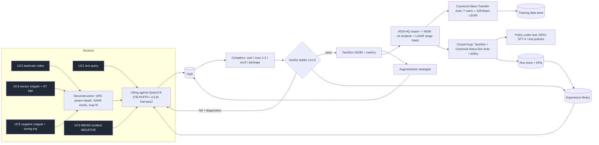

# Tanit Scenario Flywheel: Architecture v0.1 (2026-11-01)

Strategic sub-programme of TanitAD. **All core compute runs on one Jetson AGX Thor (thor3, `tsf-thor`).** The UI runs on the operator PC and talks to thor3 over the LAN.

## 1. Design principles
1. **One typed contract (TSIR).**
   - Every source is *lifted* into the Tanit Scenario IR (`src/tsf/ir/scenario.py`), and every sink is *compiled* from it.
   - The LLM never writes XML. It emits TSIR JSON under xgrammar-constrained decoding.
   - Deterministic compilers produce OpenDRIVE, OSC 1.3 XML, OSC 2.x DSL, RDS-HQ/WSM and the IMDAD `Scenario_Structure` package.
2. **Hard verifiers as the reward signal.** Every artefact passes a verifier ladder (§4). Its scores drive the self-improving harness, so the system never improves on "vibes".
3. **Two independent implementations cross-check each other.** Maps are written by scenariogeneration and read back by TanitSim's own OpenDRIVE engine. A lane-graph diff catches writer or reader bugs.
4. **Cheap-to-expensive cascade.** LLM, then the 2D sim (≈100× real time), then WSM render, then Cosmos (minutes to hours). Only scenarios that pass every cheap gate reach the GPU-heavy stages.
5. **Thor-first resource model.**
   - 122 GB of unified memory is shared by the LLM (resident) and one Cosmos model at a time.
   - A GPU scheduler serialises heavy jobs.
   - Closed loop is *sim-time-decoupled*: the world pauses while Cosmos generates the next chunk.

## 2. System overview

## 3. Components (repo map)
| Component | Path | Status |
|---|---|---|
| TSIR typed IR + JSON schema for constrained decoding | `src/tsf/ir/` | v0.1 |
| Compilers: OpenDRIVE (`xodr.py`), OSC 1.3 (`xosc.py`), OSC 2.x (`osc2.py`) | `src/tsf/compile/` | v0.1 |
| TanitSim OpenDRIVE engine (own parser; line/arc/clothoid/poly3/paramPoly3, lane graph, junctions, signals) | `src/tsf/sim/odr.py` | v0.1 |
| TanitSim engine (IDM, lane change, cut-in, signals, yielding, OBB collision, 2D TTC, closed-loop ego) | `src/tsf/sim/engine.py` | v0.1 |
| BEV renderer | `src/tsf/sim/render2d.py` | v0.1 |
| Verifier ladder | `src/tsf/verify/` | next |
| LLM client + Harness² loop + experience library | `src/tsf/agents/` | next |
| RDS-HQ exporter, WSM v4, Cosmos runners | `src/tsf/cosmos/` | next |
| Closed loop + policy adapters (REFe SFT-4 NAVSIM virtual cams, test policies) | `src/tsf/closedloop/` | planned |
| UC2 reconstruction (ViPE, DA3, SAM 3.1) | `src/tsf/recon/` | planned |
| UC3/UC5 counterfactual-twin generator (IMDAD v2 records) | `src/tsf/incident/` | planned |
| Orchestrator (FastAPI, job queue, GPU scheduler, run store) | `src/tsf/server/` | planned |
| Operator UI (React + Vite + three.js, runs on the PC) | `ui/` | planned |
| LaTeX technical report | `report/` | planned |

## 4. Verifier ladder (reward signal)
| Level | Check | Tooling |
|---|---|---|
| L0 | TSIR schema + referential integrity; package against IMDAD `scenario_schema.json` | pydantic, jsonschema |
| L1 | Standards conformance: OpenDRIVE + OSC 1.3 XSD, ASAM Quality Checker | lxml XSD, `asam-qc-opendrive` (isolated uvx) |
| L2 | Cross-implementation: TanitSim parses the generated xodr; lane graph matches TSIR intent (arms, lanes, turn movements) | `tsf.sim.odr` |
| L3 | Semantic oracle: simulate, then check TSIR assertions (turns, lane changes, collisions, min TTC, red-light, decel) | `tsf.sim.engine` |
| L4 | Intent fidelity: Qwen3.8-VL judges the query against the sim summary + BEV keyframes (rubric, 0-1) | vLLM |
| L5 | Plausibility: kinematic limits, jerk, TTC distribution vs naturalistic priors | TanitSim metrics |

The first failing level returns structured diagnostics to the agent. The repair loop is the Propose–Probe–Compose step of Harness².

## 5. Self-improving harness (Harness² + hard verifiers)
- **Editable components** (as in Harness²): system prompt, guardrails, memory, skills (few-shot TSIR exemplars), tool guidance, scripts, sub-agents, middleware.
- **Task level:**
  - Propose: the reference harness plus an invariant edit and a domain edit.
  - Probe: matched runs, scored by the verifier ladder.
  - Compose: adopt, merge or keep.
- **Library level:** entries carry `EXPERIENCE.md` (applicability, lesson, evidence). They are kept only when verifier deltas support them. Storage mirrors IMDAD's `harness_revisions` and `experience_entries` tables.
- **Additions over Harness²:**
  - Verifier-scored Pareto front over prompts (GEPA).
  - Evolving playbooks (ACE).
  - A regression corpus (every fixed failure becomes a test).
- **Human gate:** validators and invariants change only with human approval.

## 6. Use-case flows
1. **UC1 text → data:** NL query, then the Lifter agent (TSIR), then compile + verify (L0-L5 repair loop), then TanitSim, then the `Scenario_Structure` package, then RDS-HQ → WSM → Transfer-Auto (7 cams + LiDAR), then optional augmentation and closed loop.
2. **UC2 dashcam:** ViPE (`dav3` pipeline) for camera poses, intrinsics and metric depth; SAM 3.1 tracks lifted to 3D with depth and ground plane; a lane/road fit gives a parametric TSIR road, or a reconstructed `.xodr`. Then the agent writes the TSIR storyboard, and the UC1 flow follows.
3. **UC3 incident:**
   - Input is an IMDAD v2 NEGATIVE record.
   - The Lifter produces the negative TSIR, and the sim reproduces the incident.
   - The Counterfactual agent writes a positive twin: minimal edits to ego behaviour only, with the same ODD and actors. The oracle confirms risk is removed (no collision, TTC above threshold).
   - Output: a COUNTERFACTUAL_POSITIVE record linked via `lineage`. Then the UC1 flow.
4. **UC4 sensor snippet:** log replay to TSIR (ego GT, tracked agents). A semantic augmentation strategy (§7) yields variants, which go through Transfer-Auto to become training data.
5. **UC5 negative snippet:** the erroneous trajectory goes into the negative TSIR. A positive twin plus variations produce corrective training data, which are then used in closed loop with the improved model.

## 7. Augmentation strategy
Strategies are chosen by scenario semantics:
- **Appearance:** weather, time of day, lighting. These go through the Cosmos text prompt and the TSIR environment.
- **Object:** category, size and colour. These change the RDS-HQ boxes and the prompt.
- **Behaviour:** TSIR `parameters` swept by coverage-guided search (LAMBDA-style), with criticality steering by TTC and required decel. The LLM teacher steps in only on stagnation (Teach-to-Crash).
- **Map:** lane width, curvature, number of lanes.

Every variant is re-verified (L0-L5) and labelled `SYNTHETIC_AUGMENTATION`.

## 8. Closed loop (no 3DGS / NuRec)
- **World:** TanitSim owns the world state (NPCs with IDM, signals, collisions).
- **Each tick (10 Hz policy, 30 Hz render):**
  1. The ego pose is exported to the WSM renderer.
  2. Cosmos3-Nano-Sim-Auto generates the next causal chunk for the rig.
  3. The policy adapter reprojects the f-theta cameras into the policy's cameras (REFe: NAVSIM F0/L0/R0/B0 virtual pinholes, 960×512).
  4. The policy outputs a trajectory.
  5. Pure pursuit + kinematic bicycle in TanitSim advance the ego.
- **Test policies:** constant velocity; accelerate then decelerate to standstill.
- **Metrics:** EPDMS-style NC, DAC, TLC, TTC, EP, comfort, plus TanitAD's four families.

## 9. Thor resource plan (122 GB unified, 273 GB/s)
| Service | Footprint (est.) | Residency |
|---|---|---|
| vLLM: Qwen3.8-27B NVFP4 (Unsloth, MTP spec-decode) | ~23 GB weights + KV | always |
| Cosmos3-Nano-Sim-Auto (BF16) | ~32 GB + activations | on demand (closed loop) |
| Cosmos3-Nano-Transfer-Auto (BF16) | ~35 GB + activations | on demand (data gen) |
| TanitSim / verifiers / API | < 2 GB, CPU | always |
| REFe SFT-4 policy | ~1.5 GB | during closed loop |

## 10. KPIs (initial definitions; targets set after the first baseline)
| Area | KPI |
|---|---|
| Lifting (UC1/3) | first-pass validity %, validity after ≤3 repairs %, intent fidelity (L3 pass % + L4 score), time-to-valid-scenario (s), LLM tok/s |
| TanitSim | compile + load time, real-time factor, lane-graph cross-check pass % |
| Rendering | WSM render fps; Cosmos s/frame/view (Transfer, Sim); LiDAR control time |
| Recon (UC2) | ATE / RPE and scale error vs PhysicalAI-AV GT egomotion; track recall |
| Twins (UC3/5) | risk-removal rate (collision → none, TTC ↑), minimal-edit distance, ODD preservation |
| Closed loop | sim-steps/h, EPDMS, collision rate, policy latency |
| Flywheel | Δvalidity, Δfidelity per harness generation; adopted experience entries |
