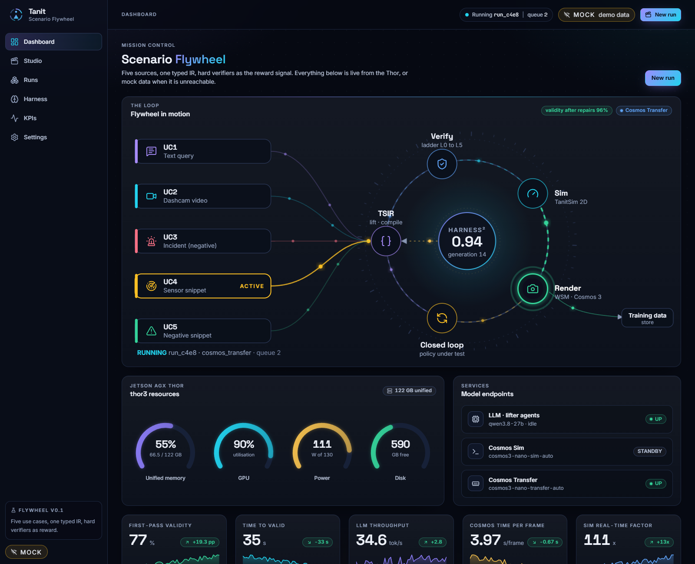

# Tanit Scenario Flywheel: operator console

React + Vite + TypeScript (strict) UI that runs on the operator PC to monitor, visualize and configure the flywheel. It talks to the FastAPI service on the Jetson Thor (`docs/API.md`) and falls back to a complete in-browser mock when the Thor is not reachable (a **MOCK** badge is always visible).



## Run it

Node 22+ and npm are enough (tested with Node 24 / npm 11, no pnpm needed).

```powershell
cd ui
npm install
npm run dev          # http://localhost:5173
npm run build        # tsc -b && vite build, output in dist/
npm run preview      # serve the production build on :4173
```

### This repo lives on Google Drive (G:)

`npm install` inside `G:\Meine Ablage\...` fails (`EBADF` / `EPERM`: Drive has no junctions and would also sync tens of thousands of `node_modules` files over your shared 100 Mbit link). Keep the sources on Drive and let a local NTFS mirror hold `node_modules`:

```powershell
cd ui
powershell -ExecutionPolicy Bypass -File scripts\sync-local.ps1             # sync + npm install (first time) + dev server
powershell -ExecutionPolicy Bypass -File scripts\sync-local.ps1 -Task build # sync + production build
powershell -ExecutionPolicy Bypass -File scripts\sync-local.ps1 -Task none   # only sync
```

The script mirrors `ui/` to `%LOCALAPPDATA%\tsf-ui` (excluding `node_modules`, `dist`) and runs the npm script there. Edit on Drive, re-run to sync. Plain `npm install` works as usual on a normal local disk.

## Point it to the Thor

1. Open **Settings** and set *API base URL* (default `http://192.168.178.182:8080`). It is stored in `localStorage` of this browser.
2. Data source: *Auto-detect* (default) probes `GET /api/health` and switches to live as soon as the Thor answers with the expected shape (`thor` and `services` keys). It re-probes with back-off while the Thor is away, so the browser console shows a few failed requests in mock mode. That is the browser logging the probe, not an app error. *Always mock* and *Always live* force a mode.
3. The browser enforces CORS for a LAN origin. Either enable it on the FastAPI app:

   ```python
   app.add_middleware(CORSMiddleware, allow_origins=["http://localhost:5173", "http://localhost:4173"],
                      allow_methods=["*"], allow_headers=["*"])
   ```

   or use the dev proxy: set the base URL to `/thor`. Vite forwards `/thor/*` (including the WebSocket) to `VITE_THOR_URL` (default `http://192.168.178.182:8080`, override in `.env.local`).

Live events are read from `WS /api/events` (`{"type": "stage|run|log|health", "run_id"?, ...payload}`). The payload fields are not specified in API.md; the UI assumes: `stage` events carry `name`, `status`, `seconds?`, `detail?`; `log` events carry `message`, `level?`, `ts?`. Every `stage` and `run` event simply invalidates the matching queries, so unknown payloads are harmless.

## Structure

```
src/
  lib/
    types.ts          API.md types, 1:1 (+ Lesson, Revision, PipelineConfig, which API.md leaves open)
    api.ts            FlywheelApi interface (one contract, two implementations)
    live.ts           LiveApi: typed fetch client + WS subscribe + probe()
    mock/             MockApi: scheduler, runs, scene generator, harness, KPIs, code artifacts
    provider.tsx      auto-detect, live/mock switching, event stream
    hooks.ts          TanStack Query hooks (keys carry mock/live identity)
    settings.ts       persisted settings store
  components/
    flywheel/         animated hero (SVG + SMIL pulses)
    run/              stage timeline, verifier ladder, BEV canvas, three.js view, scrubber,
                      camera grid, metrics, code viewer (prism)
    layout/, ui/, charts/
  pages/              Dashboard, Studio, Runs, RunDetail, Harness, Kpis, Settings
```

Route-level code splitting keeps three.js (about 250 kB gzip) and the chart library out of the first load.

## What is mocked

Everything, with the same shapes as the API: health (reacts to the running stage: Cosmos Transfer lifts memory and GPU), 13 runs of all use cases (one running, two queued, two failed), a scheduler that advances queued runs through the stages and emits events, verifier attempts with a repair loop (attempt 0 fails at L2, attempt 1 passes), generated `.xodr` / `.xosc` / `.osc` / package text, a procedural 4-arm signalized intersection `Scene` (ego changes lane left, then takes the protected-green left turn; IDM traffic obeys the signals; metrics are computed from the tracks), harness lessons, revisions and generations (your activate / retire decisions persist in `localStorage`), KPI series and pipeline config. Camera videos are not generated: in mock mode each tile draws a projection of the Scene and says so.

## Features worth knowing

- Studio: one tab per use case, three UC1 example queries, augmentation, rendering and closed-loop options, a live `POST /api/runs` preview and a Cosmos time estimate.
- Run detail: shared playback clock for the BEV canvas, the 3D view (orbit, chase, top), the camera videos and the scrubber (space plays, arrows step, shift for 1 s, click a marker to jump).
- Harness: activating or retiring an INVARIANT asks for a second confirmation (the human gate).
- Accessibility: contrast checked on the dark tokens, focus rings, roles on tabs, sliders and switches, `prefers-reduced-motion` honoured (plus a switch in Settings).
